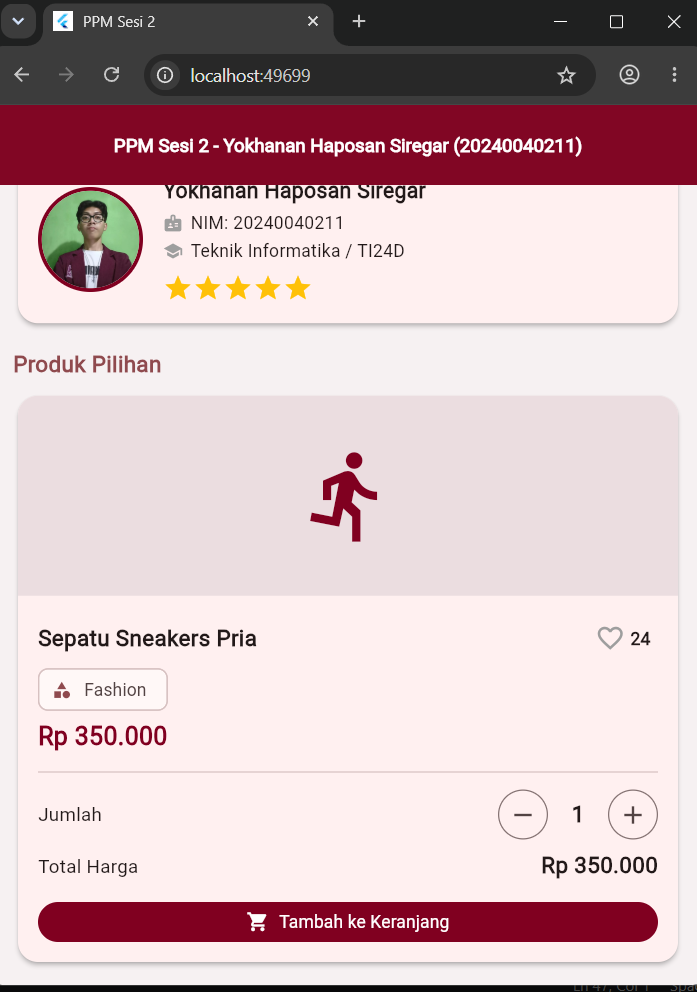
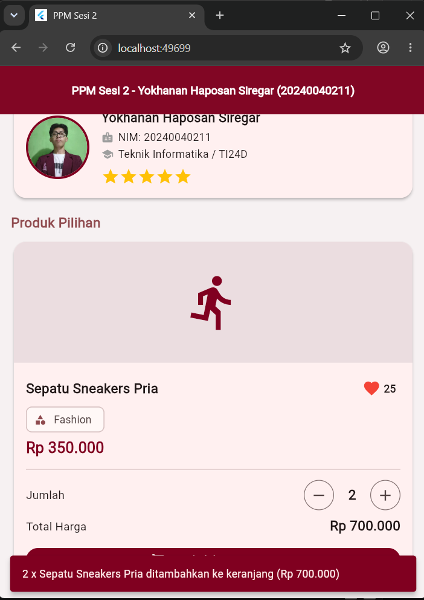

# PPM Sesi 2 - Product & Profile (Flutter)

| | |
|---|---|
| **Nama** | Yokhanan Haposan Siregar |
| **NIM** | 20240040211 |
| **Prodi / Kelas** | Teknik Informatika / TI24D |

Aplikasi Flutter sederhana yang menampilkan **banner promo**, **kartu profil mahasiswa**, dan **kartu produk interaktif**.

## Fitur

- **AppBar**: `PPM Sesi 2 - Yokhanan Haposan Siregar (20240040211)`
- **Tema**: warna maroon (`#800020`), Material 3
- **Kartu profil** (`StatelessWidget`): nama, NIM, prodi/kelas, foto profil, dan 5 ikon bintang
- **Kartu produk** (`StatefulWidget`): placeholder gambar, nama, harga, dan kategori
  - Tombol **Favorite**: ikon hati berubah (kosong ↔ penuh) dan jumlah Like bertambah/berkurang
  - Tombol **−** dan **+**: jumlah minimal 1, total harga mengikuti jumlah
  - Tombol **Tambah ke Keranjang**: menampilkan `SnackBar`
- **Banner promo**: dibuat dengan `Stack` dan `Positioned`

Widget yang digunakan: `Scaffold`, `Row`, `Column`, `Container`, `Card`, `Stack`, `Positioned`, `Icon`, `IconButton`, `FilledButton`, `StatelessWidget`, dan `StatefulWidget`.

## Struktur Project

```
ppm_sesi2/
├── assets/profile.jpg
├── lib/main.dart
├── screenshots/
├── pubspec.yaml
└── README.md
```

## Cara Menjalankan

```bash
# 1. Generate folder platform (android/ios/dll) - cukup sekali
flutter create .

# 2. Ambil dependency
flutter pub get

# 3. Jalankan di emulator / HP yang terhubung
flutter run
```

## Screenshot

> Ganti file di bawah dengan screenshot hasil aplikasi dari emulator/HP.

| Tampilan Awal | Setelah Favorite, Jumlah 3, dan SnackBar |
|---|---|
|  |  |
